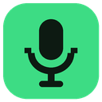
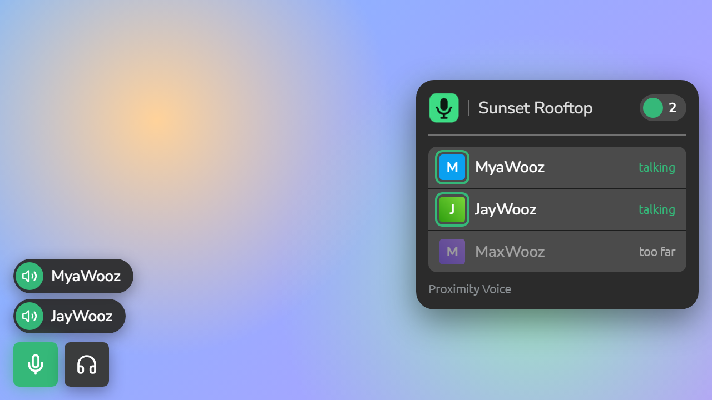
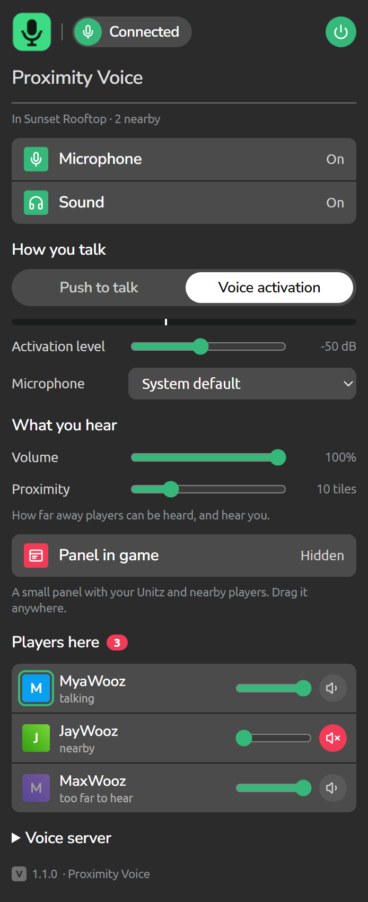

<div align="center">



# Woozworld Proximity Voice

**Talk to the players standing next to you in Woozworld.**<br>
**Parlez aux joueurs qui sont juste à côté de vous dans Woozworld.**

[](https://discord.gg/Cr3dakfNg5)


[**English**](#english) · [**Français**](#francais)

<br>


&nbsp;


</div>

<br>

<a id="english"></a>

## English

The closer you stand to someone, the louder you hear each other. Walk away and there voice fades out. No parties and no calls to setup, anyone near you with the extension can hear you.

Its a Chrome extension plus a small signaling server. Your voice goes directly to the other players (WebRTC), the server only introduce players who are in the same Unitz.

> Fan-made. Not affiliated with or endorsed by Woozworld.

### Features

| | |
| --- | --- |
| **Proximity audio** | Full volume up close, fading to silent at the range you choose (4 to 30 tiles). Players out of range dont receive your voice at all. |
| **Push to talk or voice activation** | Hold `` ` `` (or any key you pick) to talk, or let your voice open the mic, with a live level meter. |
| **Mute and deafen** | From the popup or the buttons in the bottom-left corner of the game. |
| **See who's talking** | Names pops up in the game while people talk. |
| **Voice panel** | An optional panel you can drag anywhere, shows your Unitz and the players with voice in it. |
| **Per-player volume** | Turn anyone up, down or off. Pick which microphone to use. |
| **Bring your own server** | Point the extension at your own signaling server in a couple clicks. |

### Install

1. Download the latest zip from **Releases** and unzip it.
2. Open `chrome://extensions` and turn on **Developer mode** (top right).
3. Click **Load unpacked** and pick the unzipped folder.
4. A welcome tab opens: click **Allow microphone**.
5. Open Woozworld and login. The mic and headphones buttons appear bottom-left. Hold `` ` `` to talk.

Click the extension icon for settings and the list of players around you

### How it works

| File | What it does |
| --- | --- |
| `extension/page.js` | Listens to the game's own connection (without changing it) and keeps only your player id, your Unitz, and where each player stands. |
| `extension/game.js` | Passes that to the audio page, handles push to talk, draws the in-game buttons and panel. |
| `extension/offscreen.js` | Holds the microphone and one WebRTC connection per voice player in your Unitz, and sets each one's volume by distance. |
| `extension/popup.*` | Settings and the player list. |
| `server/voice-server.js` | Groups players by Unitz and passes WebRTC connection details between them. Never touches audio. |

<details>
<summary><b>Signaling protocol</b></summary>

JSON over WebSocket at `/voice`:

```
client -> {t:'join', room, uid}      room: "<game host>#<room id>", or null for no room
          {t:'signal', to, data}     data: {description} or {candidate}
server -> {t:'hello', id} {t:'peers', peers:[{id, uid}]} {t:'join', peer} {t:'leave', id}
          {t:'signal', from, data} {t:'error', reason}   (full, taken, rate, bad)
```

</details>

### Run your own server

```bash
npm install
npm start            # ws://localhost:8795/voice   (env: PORT, HOST, MAX_ROOM)
```

The extension needs `wss://` online so put the server behind HTTPS. Two easy ways:

- **Cloudflare Tunnel** (free, no ports to open): create a tunnel, add a published application `voice.example.com` → `http://localhost:8795`, and run the server with `HOST=127.0.0.1`. `start.cmd` does this on Windows, for example as an "at startup" scheduled task.
- **Caddy:**
  ```
  voice.example.com {
    reverse_proxy /voice localhost:8795
  }
  ```

Then set the address in the popup under **Voice server**, or change `server` in `extension/defaults.js` before sharing your build. Everyone who want to hear each other must use the same server.

### Limits and privacy

- **Positions come from each player's own game**, and the server can't check them. You only send your voice to players you see near you, but a modified client could pretend to be a nearby player who has no voice on, and listen in. Only one connection per player per Unitz is allowed, so a player already in voice can't be impersonated.
- **No TURN relay.** Some strict networks (schools, offices, some mobile hotspots) blocks direct connections. Add a TURN server to `ICE` in `extension/offscreen.js` if you need one.
- **Mesh audio.** Each voice player connect to every other voice player in the Unitz. The server caps a Unitz at 40 voice players by default.
- **Range is per player.** Two players hear each other within the smaller of their two ranges.
- **Local game servers.** The extension also runs on `localhost` and `127.0.0.1`, so it works with a game server on your own computer. Remove those from `manifest.json` if you don't need them.

### Community

Bug reports, suggestions and ideas for **new extensions** are all welcome on the Discord: **[discord.gg/Cr3dakfNg5](https://discord.gg/Cr3dakfNg5)**

Any kind of extension or idea can be suggested and built, as long as it doesnt go against Woozworld's Terms of Service.

### Development

```bash
npm test
```

Tests cover the server (rooms, relaying, limits) and the game-connection reader.

<br>

---

<br>

<a id="francais"></a>

## Français

Plus vous êtes près de quelqu'un, plus vous vous entendez fort. Éloignez-vous et sa voix s'efface. Pas de groupe ni d'appel à lancer : tous les joueurs proches qui ont l'extension peuvent vous entendre.

C'est une extension Chrome et un petit serveur de signalisation. Votre voix va directement aux autres joueurs (WebRTC) ; le serveur se contente de mettre en relation les joueurs qui sont dans le même Unitz.

> Projet de fan. Non affilié à Woozworld ni approuvé par Woozworld.

### Fonctionnalités

| | |
| --- | --- |
| **Audio de proximité** | Volume maximal de près, puis de plus en plus faible jusqu'à la distance choisie (4 à 30 cases). Les joueurs trop loin ne reçoivent pas du tout votre voix. |
| **Appuyer pour parler ou activation vocale** | Maintenez `` ` `` (ou la touche de votre choix) pour parler, ou laissez votre voix ouvrir le micro, avec un indicateur de niveau en direct. |
| **Couper le micro et le son** | Depuis la fenêtre de l'extension ou les boutons en bas à gauche du jeu. |
| **Voir qui parle** | Les pseudos s'affichent dans le jeu pendant que les joueurs parlent. |
| **Panneau vocal** | Un panneau optionnel à déplacer où vous voulez : votre Unitz et les joueurs qui y ont la voix. |
| **Volume par joueur** | Montez, baissez ou coupez chaque joueur. Choisissez votre micro. |
| **Votre propre serveur** | Branchez l'extension sur votre serveur de signalisation en deux clics. |

### Installation

1. Téléchargez le dernier zip dans **Releases** et décompressez-le.
2. Ouvrez `chrome://extensions` et activez le **Mode développeur** (en haut à droite).
3. Cliquez sur **Charger l'extension non empaquetée** et choisissez le dossier décompressé.
4. Un onglet de bienvenue s'ouvre : cliquez sur **Allow microphone**.
5. Ouvrez Woozworld et connectez-vous. Les boutons micro et casque apparaissent en bas à gauche. Maintenez `` ` `` pour parler.

Cliquez sur l'icône de l'extension pour les réglages et la liste des joueurs autour de vous.

### Fonctionnement

| Fichier | Rôle |
| --- | --- |
| `extension/page.js` | Écoute la connexion du jeu (sans la modifier) et ne garde que votre identifiant, votre Unitz et la position de chaque joueur. |
| `extension/game.js` | Transmet ces infos à la page audio, gère l'appui pour parler, affiche les boutons et le panneau dans le jeu. |
| `extension/offscreen.js` | Gère le micro et une connexion WebRTC par joueur vocal dans votre Unitz, et règle le volume de chacun selon la distance. |
| `extension/popup.*` | Réglages et liste des joueurs. |
| `server/voice-server.js` | Regroupe les joueurs par Unitz et leur transmet les infos de connexion WebRTC. Ne touche jamais à l'audio. |

<details>
<summary><b>Protocole de signalisation</b></summary>

JSON via WebSocket sur `/voice` :

```
client -> {t:'join', room, uid}      room : "<hôte du jeu>#<id du salon>", ou null hors salon
          {t:'signal', to, data}     data : {description} ou {candidate}
serveur -> {t:'hello', id} {t:'peers', peers:[{id, uid}]} {t:'join', peer} {t:'leave', id}
           {t:'signal', from, data} {t:'error', reason}   (full, taken, rate, bad)
```

</details>

### Héberger votre serveur

```bash
npm install
npm start            # ws://localhost:8795/voice   (variables : PORT, HOST, MAX_ROOM)
```

En ligne, l'extension a besoin de `wss://` : placez le serveur derrière du HTTPS. Deux solutions simples :

- **Cloudflare Tunnel** (gratuit, aucun port à ouvrir) : créez un tunnel, ajoutez une application publiée `voice.exemple.com` → `http://localhost:8795`, et lancez le serveur avec `HOST=127.0.0.1`. `start.cmd` le fait sous Windows, par exemple comme tâche planifiée « au démarrage ».
- **Caddy :**
  ```
  voice.exemple.com {
    reverse_proxy /voice localhost:8795
  }
  ```

Indiquez ensuite l'adresse dans la fenêtre de l'extension, section **Voice server**, ou modifiez `server` dans `extension/defaults.js` avant de partager votre version. Pour s'entendre, tout le monde doit utiliser le même serveur.

### Limites et confidentialité

- **Les positions viennent du jeu de chaque joueur**, et le serveur ne peut pas les vérifier. Vous n'envoyez votre voix qu'aux joueurs que vous voyez près de vous, mais un client modifié pourrait se faire passer pour un joueur proche qui n'a pas la voix activée, et écouter. Une seule connexion par joueur et par Unitz est acceptée : un joueur déjà en vocal ne peut donc pas être usurpé.
- **Pas de relais TURN.** Certains réseaux stricts (écoles, bureaux, certains partages de connexion) bloquent les connexions directes. Ajoutez un serveur TURN à `ICE` dans `extension/offscreen.js` si besoin.
- **Audio en maillage.** Chaque joueur vocal se connecte à tous les autres joueurs vocaux de l'Unitz. Le serveur limite un Unitz à 40 joueurs vocaux par défaut.
- **La distance est réglée par chaque joueur.** Deux joueurs s'entendent dans la plus petite de leurs deux distances.
- **Serveurs de jeu locaux.** L'extension fonctionne aussi sur `localhost` et `127.0.0.1`, pour un serveur de jeu sur votre propre ordinateur. Retirez-les de `manifest.json` si vous n'en avez pas besoin.

### Communauté

Rapports de bugs, suggestions et idées de **nouvelles extensions** sont les bienvenus sur le Discord : **[discord.gg/Cr3dakfNg5](https://discord.gg/Cr3dakfNg5)**

N'importe quel type d'extension ou d'idée peut être proposé et créé, tant que cela ne va pas à l'encontre des Conditions d'utilisation de Woozworld.

### Développement

```bash
npm test
```

Les tests couvrent le serveur (salons, relais, limites) et la lecture de la connexion du jeu.

<br>

---

<div align="center">

**License / Licence :** MIT · Fonts / Polices : [Ubuntu](https://fonts.google.com/specimen/Ubuntu) and / et [Nunito Sans](https://fonts.google.com/specimen/Nunito+Sans) (`extension/fonts/`)

</div>
